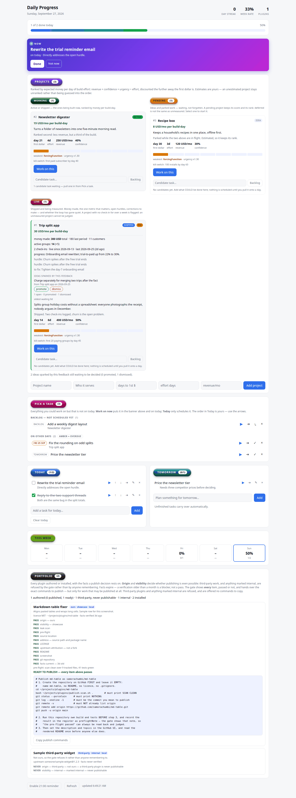

# dsh-daily-progress-tab

Daily planning, venture tracking and a post-launch feedback loop for DSH — **in its own browser
tab**, driven by the harness agent as much as by hand.

Open **`http://127.0.0.1:3080/daily-progress-tab/ui`** in a tab and drag it to a second
screen. There is no dock widget, no composer strip, and no harness UI footprint at all.

**Available for work:** I build and audit DSH plugins, including the client half most authors can't
get working — [how to reach me](#work-with-me).

Forked from [`omdsh-dev/dsh-daily-progress`](https://github.com/omdsh-dev/dsh-daily-progress)
at `bedbd28de735ee1c49d684d922a3d8009bd21431` (see `UPSTREAM_COMMIT.txt`).

> **The design record lives in this repository.** The ranking method is under [Ranking](#ranking),
> the feedback-loop design under [The feedback loop (Live)](#the-feedback-loop-live), the state model
> under [Storage](#storage), the publication gate under [What the gate shows](#what-the-gate-shows),
> the two publish settings under [Configuration](#configuration),
> and every defect this fork fixed under [Differences from upstream](#differences-from-upstream).
> Where a fixed defect has a test, that test is the durable half of the record: it fails if the defect
> comes back.

## What it looks like

<picture>
  <source media="(prefers-color-scheme: dark)" srcset="docs/planner-dark.png">
  
</picture>

**The projects, tasks and plugins in that image are sample data.** The page is a real render of the
real plugin, and the store behind it was seeded through the plugin's own `/mutate` API — so nothing
on screen is drawn by hand — but the ventures are invented. The page this plugin serves for its
author carries the author's actual register: revenue, kill-switches, live metrics. That is exactly
the material the [portfolio gate](#what-the-gate-shows) exists to keep out of a public repository, so
it is not what you are looking at.

**The publish commands in that image name a placeholder account and the scanner that ships in this
repository.** They are config values, not constants. An earlier version compiled the author's own
GitHub account and the path to the author's private scanner into the command block, so every reader's
page offered a command aimed at an account that was not theirs — and the leak scan reported CLEAN over
it, because a lexical scan cannot tell an account name from a word. Set
[`publishOwner`](#publish-owner-and-scanner) and the block is yours.

[The image is three commands to reproduce](#reproducing-the-screenshot), not a hand-drawing.

## What you get

- **Now** — the *one* task being worked on, as a filled banner at the top. Every task row on the page
  has a ▶ that picks it; finishing or deleting it clears the pick automatically
- **Today** — checklist with add / check off / edit / remove, **↑↓ to order it**, ▶ to work on a task,
  ➔ to push it to tomorrow
- **Tomorrow** — write the evening plan; unfinished items carry over automatically
- **Pick a task** — the menu of everything that is *not* today, in two halves:
  - **Backlog** — candidate tasks, **undated**, attached to a project and waiting there
  - **On other days** — undone tasks sitting on another day (amber = overdue), with ➔ to pull one
    into today
  Each row offers ▶ *work on this now* (schedules it **and** picks it), ➔ *schedule only*, ✓ *mark it
  done where it is*, and × *drop it*
- **Focus** — the one project being executed, with its tasks pulled out of today and tomorrow
- **Projects** — a ranked board in **three lifecycle columns**:
  - **Working** — `active`: being built now, ranked by expected money per day of build effort
  - **Pending** — `idea` / `parked`: waiting, and *keeping its score and rank* — deferred is not the
    same as unmeasured
  - **Live** — `shipped`: in the world and being **measured** (see the feedback loop below)
  Each project card carries a one-line **Backlog** input, so candidates are authored where the
  project is rather than in a separate list
- **Thermometer** — today's completion rate as a bar
- **Streak** — consecutive achieved days; an unfinished today *pauses* it, never breaks it
- **Week heatmap** — Monday-first, counts only through today
- **21:00 reminder** — opt-in; fires if tomorrow still has no plan
- **Section headings are coloured bubbles** — one hue each, so a card is findable at a glance

### Colour is two families, and the split is load-bearing

`--ok` / `--warn` / `--danger` / `--accent` are **decoration**: fills, borders, bars. They are chosen
to look right as areas, which makes them far too light to read as text — measured on a rendered page,
amber text was **2.39:1** and green **3.73:1** against the light theme's ground, where small text
needs 4.5:1. The `-ink` variants are the same hues darkened (light) or lightened (dark) until every
one clears the bar: after the fix the same text measures **8.85:1** and **9.71:1**.

**Never use a decoration token for text, and never use an ink token as a fill** — white on the dark
theme's light-red ink is 2.77:1, a mistake made and caught while fixing this. Both rules are enforced
by `tests/ui.test.ts`, which also computes the contrast of every text token against both surfaces of
both themes, so a palette change cannot regress it silently.

**A state class must not rely on source order.** Two single-class rules have equal specificity, so
whichever is declared later wins. `.spark-due` declared amber for the triage warning and rendered
`--muted`, because `.closed-line` came later in the stylesheet: 0 amber pixels on the page where a
sibling amber line measured 827. Qualify the modifier — `.closed-line.spark-due` cannot be beaten by
order — and note that a dead declaration is indistinguishable from a working one in the source, so an
emphasis rule has to be *measured* on the render. A third gate in `tests/ui.test.ts` now fails on any
text colour that is overruled on every element using it.

Achieved day = at least one item and all of them done. Past days are read-only.

### Why "Pick a task" exists

Before it, a task could only come into existence **already attached to a date**. Everything you could
work on was therefore something the board had already put in front of you, and the ranking — not the
operator — decided the menu. The backlog is the missing piece: an **undated** candidate task that
waits on its project until someone pulls it onto a day. That is what makes "work on any task I
choose" mean something.

The three surfaces are independent, and each answers a different question:

| question | surface |
|---|---|
| what am I doing *right now*? | **Now** (one task, picked, cleared when it is finished) |
| what *could* I do for a project? | **Backlog** (undated, per project) |
| what did I already plan that is not today? | **Pool** ("On other days") |
| in what order will I do today? | the **↑↓** arrows — the array order *is* the priority |

## Ranking

`score = (revenuePerMonth × confidence) × timeDiscount × urgency ÷ effortDays`, where
`timeDiscount = 1 / (1 + ttfdDays / 30)` and `urgency = 1 + 0.15 × (forcingFunction − 1)` — WSJF
adapted so **time to the first dollar is a first-class term**. Units are "expected currency per
month, per day of build effort", so the order literally answers *what makes money fastest for the
work it costs*.

An unestimated project is **never guessed into the order** — with no revenue, effort or
time-to-first-dollar it sorts after every scored project and is labelled **UNRANKED**. The
seven-dimension rubric is a **gate, not a score**: the lowest dimension is reported as
`weakest: <dimension>` rather than averaged away. The rubric, the score and the discounting live in `src/projects.ts`.

## The feedback loop (Live)

A shipped project is not finished, it is **live**. Each project carries a `metricName` — the *one*
number that matters — and gets **check-ins**: one dated record per period holding the money taken
that period, the metric, paying customers, what progressed, **hurdles**, **corrections**, and a
verdict of `continue · fix · pause · kill`, judged against the kill-switch agreed before launch.

- A re-check-in on the same day **updates that day** rather than adding another, so money can never
  be double-counted by a restatement.
- No check-in for more than **7 days** flags the card **STALE** — an unmeasured project cannot be
  judged.
- **Deleting a project deletes its check-ins.** Leaving them behind kept a deleted venture's
  money and verdicts on disk, invisible on the board — found by dumping the raw store, and now
  covered by a probe that reads the table directly rather than the snapshot.
- A **`kill` verdict is an action**: it sets the status to `killed`, the project leaves the board,
  and the register keeps the reason. Killed projects are counted under the column, never
  silently hidden.
- Everything shown is derived on read from the check-ins, so the summary cannot drift from them.

Implementation: `src/projects.ts` derives the whole monitoring block on read, so the summary
cannot drift from the check-ins. `tests/projects.test.ts` pins the staleness threshold, the period
figures, the metric delta and the killed bucket.

## Sparks — the business ideas the feedback produces

A check-in does not only say whether the venture is working; it says what *else* is true. A hurdle
that keeps recurring is often a product of its own, and a customer request that does not fit the
current offer is a second business. Those ideas are captured as **sparks**, listed on the live card
under `IDEAS SPARKED BY THIS FEEDBACK` and counted at the foot of the Live column.

- Capture is **one more list on `daily_checkin`** (`sparks: ["..."]`), so it costs one word more than
  a hurdle — or `daily_spark` for an idea that strikes on its own, with no live project behind it.
- A spark is keyed by its **own id**, and its source is a **soft reference that is allowed to dangle**:
  `sourceProjectName` is frozen at capture, so the record still says where it came from afterwards.
- **Deleting a project keeps its sparks** — the one deliberate exception to "deleting a parent deletes
  its children". A check-in is a child of the project; a spark is a lead it produced, and a venture
  that dies of a hurdle is telling you the hurdle *is* the business. Probes assert they survive.
- Two exits, and no third state: **promote** turns it into a Pending project with no estimates, so it
  starts **UNRANKED**; **dismiss** closes it and **requires a reason**, so a dead end stays dead.
- **A spark never closes a hurdle.** Only `daily_checkin_item` does. Otherwise "write down an idea"
  silently counts as "fixed the problem" and the fix list stops being a work list.
- **Re-running a check-in replaces only the OPEN sparks** — a decision already taken is not undone by
  restating the feedback that produced it.
- An idea left undecided for more than **14 days** trips a triage warning on the card and in the
  column, because a capture surface with no clock only ever grows.

Implementation: the `spark*` operations in `src/planner.ts`; `tests/sparks.test.ts` pins the
queue, the ageing clock and the decided history.

## The plugin portfolio register

Every plugin authored or installed is recorded once, with the facts a publish decision rests on:

| field | why it is load-bearing |
|---|---|
| `origin` | `ours` / `fork` / `third-party`. **Only `ours` and `fork` can ever be published** |
| `visibility` | `showcase` / `internal`. Defaults to **`internal`**, so nothing becomes publishable by omission |
| `upstream` | a fork must record its upstream repo and commit, or the gate blocks it |
| `licence`, `hasLicenseFile` | attribution is not optional |
| `sourceOutsideProfile` | false means the only copy sits inside a profile's `node_modules` — a single point of failure |
| `leakScanPassed` + `leakScanAt` | the scan must have passed for the **current** tree |
| `verifiedAt` | every fact above expires: older than 30 days is a blocker, not a pass |

The counts — `2 authored (0 published, 0 ready) · 1 third-party, never publishable · 2 installed` —
are **derived** from the records on every read, so the number can never be one somebody typed.

**This is a register with a gate, deliberately not a "publish" button.** A list of *installed*
plugins contains other people's work, and a button on that list is one click from publishing someone
else's repository under your own name. Here that is impossible rather than merely discouraged: a
third-party plugin has no publishable state at all, and the card shows why in a muted tone — a fact,
not a to-do list. Anything fixable is shown as `blocked:` in amber instead, so the two are never
confused.

Facts expire for the same reason: a leak scan that passed months ago says nothing about the tree
today, which is exactly when a private path or a token gets committed.

## Driving it by asking (agent tools)

The plugin registers **29 tools**, so the plan, the board, the backlog and the feedback loop can all be managed
conversationally:

| Tool | What it does |
|---|---|
| `daily_plan` | read the WHOLE board: now, today, tomorrow, the pool and the backlog |
| `daily_add_task` | schedule a task on today or tomorrow |
| `daily_set_task_done` | complete (`done:true`) or reopen (`done:false`) a task |
| `daily_edit_task` | rewrite a task's text |
| `daily_move_task` | move a task to another date — defer, reschedule, or pull one forward with `fromDate` |
| `daily_reorder_task` | move a task one place up or down in its list |
| `daily_now` | pick, change or clear the ONE task being worked on |
| `daily_remove_task` | delete a task |
| `daily_suggest` | attach a row of suggestion chips to a task |
| `daily_update_task` | change a task's summary box or project link |
| `daily_backlog_add` | add an **unscheduled** candidate task to a project |
| `daily_backlog_plan` | schedule a candidate onto a day (optionally `select:true` to start it now) |
| `daily_backlog_remove` | drop a candidate that is not wanted after all |
| `daily_projects` | read the ranked board |
| `daily_add_project` | add a venture (name, who it serves, estimates, rubric) |
| `daily_update_project` | change estimates, rubric, status, kill-switch, `metricName` |
| `daily_select_project` | choose what is being executed (`idea`/`parked` → `active`) |
| `daily_plan_project` | break a project into linked daily tasks in one call |
| `daily_live` | read the Live board: money, metric, hurdles, corrections, verdicts, staleness |
| `daily_plugins` | read the plugin portfolio register: origin, licence, publication state, and the blockers before publication |
| `daily_plugin` | record or update ONE plugin (origin is required: ours / fork / third-party) |
| `daily_plugin_remove` | drop a register row — never touches the code or the repository |
| `daily_checkin` | log a check-in (money, metric, progress, hurdles, corrections, verdict, **sparks**) |
| `daily_checkin_item` | close or reopen one hurdle or correction |
| `daily_sparks` | read the spark board: open ideas, their triage clock, and every dismissal with its reason |
| `daily_spark` | capture ONE business idea, optionally attributed to the venture whose feedback produced it |
| `daily_spark_promote` | turn an idea into a Pending project (UNRANKED until it is estimated) |
| `daily_spark_dismiss` | close an idea without starting it — a reason is required |

Every task tool addresses a task by `itemId` **or** by `task`, a unique case-insensitive substring
of its text — the model usually knows what a task says, not its UUID. An ambiguous substring
is **refused with the candidate list**, never guessed. Projects resolve by `projectId` or `project`
(a unique substring of the name), and **`daily_plan_project` resolves a name to an id first** —
passing a name straight to `addItem` (which links by id) would silently create unlinked tasks.

Tools are registered inside `ctx.inject(['tools'], …)`, not in the plugin's required `inject`:
a profile composed without a tool registry still boots the planner, it just gets no tools.

### What the gate shows

Every item is drawn, passed or not &mdash; twelve of them for a publishable plugin &mdash; because a
gate that shows nothing when it is green cannot be told apart from one that never ran, and *"it said
ready"* is not a record of what was checked.

| state | meaning |
|---|---|
| `pass` | the fact holds, as of `verifiedAt` |
| `todo` | an outstanding fact, with what to do about it |
| `never` | a permanent refusal &mdash; not work, so it is drawn muted rather than amber |

**The commands to publish appear when, and only when, every item passes**, and never for third-party
or internal work. That is a guarantee in the code rather than a button hidden at render time: the
command builder returns the empty string, so neither the page nor the model has anything to offer.
Third-party work gets no checklist to work through either &mdash; a to-do list for something that must
not happen reads as an invitation to start it.

**A green row with no commands says why.** Publishing is a property of the plugin; the account to
publish under is a property of the *deployment*. So a row that passes every item while no
`publishOwner` is configured names that field on the row instead of sitting above nothing — the one
shape the `address` gate item exists to prevent. The gate stays at twelve items: a setting nobody has
filled in is not a defect in the plugin, and reddening every row for someone who never publishes would
be worse than the blank it fixes. See [Publish owner and scanner](#publish-owner-and-scanner).

**The plugin executes nothing.** There is no `child_process`: the agent runs the pre-flight (build,
tests, leak scan) and records the outcome with its date, and the gate displays that note, so "the
pre-flight passed" can always be read back and judged. The irreversible step &mdash; the push &mdash;
stays with a human; the toil does not.

**Gate items:** `origin`, `visibility`, leak scan, pre-flight, source location, publish address,
LICENSE, upstream attribution, README, screenshot, git repository, and recency. A fork must record its
upstream repository and commit, and an unverified fact counts as missing rather than true.

### The public export

The register is a private console: it carries the gate, the blockers and the exact shell to publish.
**`daily_export` renders the part of it that belongs in public** — and refuses the rest by construction:

| rule | why |
|---|---|
| only records that are `public` **and** carry a URL appear | a résumé that links to a repository that does not exist is worse than a short one, and this is what makes the published COUNT equal the list |
| `internal` and `third-party` never appear | the gate refuses them; a résumé must not be the way around it |
| no commands, no scan notes, no dates, no checklist | that is the console's language, and one of those strings is a private path |
| a document without the marker pair is **refused**, not appended to | appending a generated block to a hand-written readme is how a document starts lying about itself |

```bash
curl -s 'http://127.0.0.1:3099/daily-progress-tab/export/readme' | head -8
```

The section lives between two markers in whatever document you keep it in:

```
<!-- dsh-portfolio:begin — generated, do not edit by hand -->
#### Plugins
…
<!-- dsh-portfolio:end -->
```

`daily_export` takes the document's current TEXT and returns it spliced — it writes no files. The agent
reads the file, calls the tool, writes the result; the plugin composes, the agent acts, the human
decides. That is deliberate, and it is the same division of labour as the publish gate.

**Verified against the real register, which is the point of deriving it:** with nothing published the
export says *"Nothing published yet."* The number in public cannot disagree with the register, because
it is the same number.

### Configuration

| field | default | what it does |
|---|---|---|
| `timezone` | the host's zone | the zone agent-initiated calls resolve "today" in. Browser requests carry the user's own zone and date; a tool call carries neither |
| `publishOwner` | *(empty)* | the GitHub account the publish commands push to. **Empty withholds the commands** |
| `leakScan` | *(empty)* | the scanner those commands run. **Empty emits an instruction instead** — never a path that exists on one machine and nowhere else |

```yaml
- id: daily-progress-tab
  config:
    timezone: Africa/Nairobi
    publishOwner: your-github-handle
    leakScan: '~/projects/plugins/leak-scan.sh'   # QUOTED: a bare leading ~ is a YAML null
```

### Publish owner and scanner

These two belong to the deployment, not to the plugin, and neither has a default in code. **That is a
fix, not a gap.** The command block used to be built from two constants holding the author's GitHub
account and the path to the author's private scanner, so a reader's page handed over a command that
pushed to an account that was not theirs. `tests/portfolio.test.ts` now asserts mechanically that
neither constant can come back.

What an unconfigured deployment gets, in order:

- **No `publishOwner`** — the gate still reports every item, the row still says READY TO PUBLISH, no
  commands are emitted, and the row names the field to set.
- **No `leakScan`** — one line of the block becomes an instruction to run your own scan, so the rest of
  the sequence stays usable. The repository ships one: `bash scripts/leak-scan.sh .` prints
  `SCAN CLEAN` or the places that are not, never the secret it found.
- **A value that is set but cannot be pasted** — a space, a `;`, a `$(…)` — yields **no** commands
  rather than a different command. The text is copied and pasted, so a metacharacter in it is an
  instruction to a shell.

## Suggestion chips

`daily_suggest` attaches up to 6 chips to a task; the page renders them under it and clicking
one applies it **server-side** (`applySuggestion`), so the semantics live in one place. An
applied chip is consumed, and `info` chips never round-trip — they just reveal their detail.

| action | needs | effect |
|---|---|---|
| `complete` | — | mark the task done |
| `defer` | `date` (`YYYY-MM-DD` or `tomorrow`) | move the task to that date |
| `split` | `items` (1–20 texts) | replace the task with those tasks |
| `retitle` | `text` | rewrite the task |
| `drop` | — | delete the task |
| `info` | `detail` | nothing — explains, shown inline |

The model authors the content; the plugin never calls a model itself.

## Routes

| Route | Purpose |
|---|---|
| `GET /daily-progress-tab/ui` | the planner page (also at the bare prefix) |
| `GET /daily-progress-tab/state?localDate=YYYY-MM-DD&tz=IANA` | snapshot (includes `pending`, `live` and the derived `monitoring` per project) |
| `POST /daily-progress-tab/mutate` | `{localDate, tz, op, payload}` |
| `GET /daily-progress-tab/export/readme` | the public résumé section as markdown, generated from the register |
| `GET /daily-progress-tab/export/site` | the same records as a standalone page (what a Pages site would serve) |

Ops (17): `toggleItem` · `addItem` · `removeItem` · `editItemText` · `updateItem` · `setTomorrow` ·
`clearToday` · `moveItem` · `splitItem` · `setSuggestions` · `applySuggestion` · `addProject` ·
`updateProject` · `removeProject` · `selectProject` · `logCheckin` · `checkinItem`

`match` is the text matcher; `text` is always a text *value*. Keeping them separate matters:
letting `text` serve both made `editItemText` read one field for two purposes and silently no-op.
In a partial update, **`undefined` means "leave it" and `null` means "clear it"** — collapsing the
two is what made a summary-only edit fail with `empty_text`.

All routes are loopback-only. The prefix, the bundle row id, and the storage domain name are all
`-tab`-suffixed so this fork can coexist with an upstream install (domains may be opened once per
process, and `webServer.register` throws on a duplicate prefix).

## Storage

Domain `daily_progress_tab`, **version 1** — deliberately not bumped despite tables and fields being
added since. Bumping it would make the existing medium reject at open, i.e. the plugin would refuse
to start on the very store it created. New tables simply load empty, and new **schema fields are
optional** so records written earlier still validate. Tables: `plans` (one record per
`<scope>:<date>`), `projects`, `checkins` (one record per `<projectId>:<date>`), `backlog` (one
record per candidate task id), plus a domain `global` holding the selected project **and** the
selected task.

Two rules learned the hard way here:

- **The global is read-then-merged on every write.** `global.set` replaces the whole record, so
  writing the project choice would silently drop the task choice — the fields are independent
  selections, and `patchGlobal` re-reads before it writes. A probe asserts that picking a task does
  not clear the selected project.
- **Deleting a project deletes what belonged to it** — its check-ins *and* its backlog candidates.
  Orphans are invisible on the board but still on disk, read by anything walking the table (and by
  the next backup dump). Both are probed against the raw table, because the snapshot cannot see them
  by construction.

The selected task is stored as an **id plus a hint date**, and is re-resolved on every read
(hint day → today → the whole ±14-day pool window). A moved, completed or deleted task therefore
cannot leave a dangling "working on" pointer; a task that resolves to `done` is refused outright
rather than shown as the one you are on.

## Install

**Do NOT use `dsh plugin --profile web add`.** On this machine that command forwards to pnpm with
`cwd` = the profile directory (`lib/bin.js:96`, `lib/plugin-9h8shc4d.js:108` in the DSH CLI), which
materialises a second `@deepseek-ai/dsh-*` tree and kills every tool call — the failure this plugin's
own warning below describes. This plugin declares its `@deepseek-ai/*` dependencies as
**peerDependencies**, which is precisely the shape that triggers it.

Copy real files and register them in the profile's patch layer instead:

```bash
DEST="$HOME/.dsh/profiles/web/node_modules/dsh-daily-progress-tab"
mkdir -p "$DEST"
cp -r lib package.json "$DEST"/
```

```yaml
# ~/.dsh/profiles/web/cordis.patch.yml  (append)
- insert:
    - id: daily-progress-tab
      name: 'dsh-daily-progress-tab'
      config:
        timezone: Africa/Nairobi
        # Both optional, and empty means UNSET: with no publish owner the register
        # withholds the publish commands and names the field on the row.
        publishOwner: your-github-handle
        leakScan: '~/projects/plugins/leak-scan.sh'
```

Dependencies need no install: `@deepseek-ai/*` resolves through `~/.dsh/profiles/node_modules/`, the
shared tree of symlinks into the single global copy. Then restart: `dsh web`, and open
`/daily-progress-tab/ui`.

⚠️ **Never run a package manager inside `~/.dsh/profiles/*`** — it materialises a second
`@deepseek-ai/dsh-*` tree, and two copies mean two `Symbol` instances and every tool call dying
with `Cannot read properties of undefined (reading 'prepare')`. Copy the package in as real files.

## Develop

```bash
npm run typecheck   # tsc against the REAL @deepseek-ai types
npm test            # 128 unit tests (scoring, ranking, monitoring, metrics, page structure, contrast, the scanner)
npm run build       # tsc → lib/
npm run probe       # 312 live probes: real cordis, real json backend, real tool registry
npm run render      # serve the page on a bare http server for pixel verification (see below)
```

### Verifying the page without a DSH instance

A visual change has to be **rendered and measured** — reading the CSS proves nothing. That normally
means a scratch DSH instance, but a scratch instance is a whole profile composition and does not
survive a reboot. For a change that is purely presentational, nothing about the DSH host matters:
what has to be real is the PAGE and the DATA.

`npm run render` mounts the same three real pieces the plugin uses — `createHandlers` over
`createPlanner` over the real json store — and stubs only the host's route registration:

```bash
PORT=3179 STORE_DIR=/tmp/dsh-planner-render/storages npm run render
PUBLISH_OWNER=your-github-handle LEAK_SCAN=scripts/leak-scan.sh node scripts/render-ui.mjs
```

Then screenshot it with the driver this repository ships — **in both themes**, because the page declares
`prefers-color-scheme: light dark`, so a single screenshot silently verifies half its surfaces:

```bash
node scripts/screenshot.mjs http://127.0.0.1:3179/daily-progress-tab/ui ~/shots/planner-dark.png \
  --theme dark  --full --wait '.pfol-row'
node scripts/screenshot.mjs http://127.0.0.1:3179/daily-progress-tab/ui ~/shots/planner-light.png \
  --theme light --full --wait '.pfol-row'
```

The theme is **forced** (`--blink-settings=preferredColorScheme`), not inherited: a snap Chromium
cannot see the host theme, so an unforced render follows the OS and can differ between two runs minutes
apart. `--wait` matters for the same reason a fragment link does not survive here: the rows arrive from
a fetch *after* the load event, so "the HTML contains the string" proves nothing about what a reader
sees.

`--click` dispatches **real** mouse events at an element's centre, and `--after` evaluates a second
expression once they have run. Both exist because a JS `.click()` is not a user activation: anything
gated on one — `window.open` in particular — silently fails, and a working button reports as broken.
A click test also needs to read the state the click *produced*, which a grade that ran before it
cannot see.

**Why the driver writes the file itself.** The PNG is written by the Node process from the base64 CDP
returns, never by a browser-side `--screenshot` path — Chromium here is snap-confined, writes `/tmp`
screenshots into its own private namespace and is denied `~/.cache`, and it reports success either way.
Take the image from the process that can see the bytes, and write it to a visible path under `$HOME`.

### Reproducing the screenshot

The image at the top of this README is three commands and no hand-drawing. From an empty store:

```bash
# 1. serve the real page over a demo store (your values; this machine's real ports are refused)
STORE_DIR=/tmp/demo-store PORT=3098 PUBLISH_OWNER=your-github-handle \
  LEAK_SCAN=scripts/leak-scan.sh node scripts/render-ui.mjs &

# 2. fill that store through the plugin's own /mutate API, so every record passes the
#    schema it will be read back through, dated off today
PORT=3098 python3 scripts/seed-demo-store.py

# 3. grade the RENDERED DOM, then shoot it in both themes
node scripts/screenshot.mjs http://127.0.0.1:3098/daily-progress-tab/ui docs/planner-dark.png \
  --theme dark --full --wait '.pfol-row' --grade scripts/grade-demo.js
node scripts/screenshot.mjs http://127.0.0.1:3098/daily-progress-tab/ui docs/planner-light.png \
  --theme light --full --wait '.pfol-row' --grade scripts/grade-demo.js
```

`grade-demo.js` prints counts read from the rendered DOM — project cards, gate marks, the register's own
count line. If a card did not render, the picture is not evidence of it, so the numbers are checked
before the shutter: a first run of this chain produced a row that was 11-of-12 with no commands,
because the sample record had no source path, and reading the DOM is what caught it.

The seeder refuses a port it was not told to use, refuses this machine's real ports, and refuses a store
holding records it did not write — it fills a demo, and the register it protects is not a demo.

`probe` mounts the plugin on a real cordis `Context` with real service names, so a wrong name in
`inject` fails the probe rather than passing silently — and it drives every tool, every suggestion
action, the whole check-in loop and the whole choosing flow end-to-end. **Every logic bug in this
fork was found by the probe; none by re-reading code.** Keep it that way: a fixed bug gets a new
probe.

`tests/ui.test.ts` covers the page, which nothing else can: it has no build step and no imports, so a
typo in an element id renders **nothing** and fails silently. It asserts that the template literal
contains no backtick and no interpolation marker, that every id the script looks up is defined, and
that every bubble heading has a style rule. Both of those checks have already caught real breakage.

For the chain that matters before a deploy — typecheck → tests → build → snapshot → copy →
verify — this repository ships its own runner, and it **never restarts the server**, because that
would kill the session you are working in:

```bash
scripts/deploy.sh              # build, verify, deploy into $PLANNER_HOME (default ~/dsh-planner)
scripts/deploy.sh --check      # report drift and change nothing
scripts/deploy.sh --rollback   # restore the previous snapshot
```

Restart the instance yourself, then re-render to see what you changed.

UI changes should be **rendered and looked at**, not reasoned about from the CSS — see
[Verifying the page without a DSH instance](#verifying-the-page-without-a-dsh-instance) above for the
harness and the two-theme rule.

## Differences from upstream

**Fixed — each aborted DSH's boot:**

1. `dsh.client` manifest + `exports["./client"]` removed. Upstream declared a client half whose
   `lib/client.js` was never built; `dsh-client-modules` then failed the whole plugin tree with
   `client bundles not found`.
2. `inject` corrected from `httpServer` to **`webServer`**. `httpServer` does not exist in the
   harness; the entry stayed pending and `assertEntriesActivated` aborted the boot.

**Fixed — runtime defects:**

3. **Lost-update race.** Mutations hand-rolled get→put; 8 concurrent adds persisted 1 item. Every
   read-modify-write now runs on one process-wide write chain (8/8 persist).
4. **Unhandled rejection.** The rollover write was fired with `void` and no catch — a backend
   failure raised an unhandled rejection (fatal by default) while the request returned 200.
5. **IPv6 loopback rejected.** Bracket-stripping ran before the port split, collapsing
   `[::1]:3080` to `''`; the `'::1'` branch was dead code.
6. `removeItem` reported success for a nonexistent id.
7. `setTomorrow` accepted duplicate ids, so one toggle flipped several items.
8. The GET path did not bound `tz`, persisting arbitrarily long strings.
9. Internal error text was returned to the browser.

**Fixed — contract and hygiene:**

10. Real `peerDependencies` on the harness packages + `@deepseek-ai/cordis` types, replacing a
    hand-written `declare module 'cordis'` shim. The shim is *why* upstream shipped a service name
    that does not exist: it invented `httpServer`, so `tsc` passed. With real types this fork's
    typecheck fails immediately on a wrong service name.
11. `zod` 3 → 4, matching the host's `^4.4.3`.
12. `lib/` is committed, so a clean checkout runs.

**Added:** the standalone planner tab (no client bundle, so nothing for `dsh-client-modules` to
compose), the ranked projects board, the Working/Pending/Live columns, the check-in feedback loop
with staleness flagging, a per-project backlog, a task-level Now pick, the 29 agent tools, suggestion
chips, bubble headings, the `timezone` / `publishOwner` / `leakScan` config fields,
and the optional-`tools` registration.

Known gap: no `src/invariant.ts` / `./invariant` export (the harness package convention).

## Work with me

I build and audit **DeepSeek Harness plugins**. In practice that means:

| | |
|---|---|
| **Plugin build** | a dual-face plugin — host routes plus a real client UI — installed safely, with a rollback, and the awkward parts written down instead of hand-waved |
| **Plugin audit** | a written report: verdict first, `file:line` findings against a pinned commit, and an honest section on what it does well |
| **Profile rescue** | a harness throwing `Cannot read properties of undefined (reading 'prepare')` after a plugin install — I have recovered this twice and published the procedure |

Available for work — **open an issue on this repository** (no address needed, nothing exposed), or
reach me through [my GitHub profile](https://github.com/samorachumbi).

Other work of mine: [`dsh-cost-bubble`](https://github.com/samorachumbi/dsh-cost-bubble) — a live
client-half plugin — [`dsh-app-launcher`](https://github.com/samorachumbi/dsh-app-launcher), the Apps
pill that opens pages like this one, and
[the install guide](https://github.com/samorachumbi/dsh-plugin-install-guide).

## Licence

BSD-3-Clause, as upstream. Upstream copyright © 2026 Zacklinkk.
